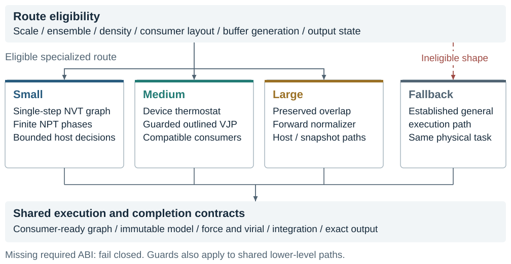

# DPA4C Scale-Aware MD

Source and analysis artifact for scale-aware, end-to-end DPA4C molecular-dynamics
optimization on a PPU accelerator. Maintainer: **Chengxiang Luo**
([luochengxiang@dp.tech](mailto:luochengxiang@dp.tech)).

This repository accompanies *Scale-Aware End-to-End Acceleration of DPA4C
Molecular Dynamics: A PPU Case Study*. The repository is hosted at
[cx-luo/dpa4c-scale-aware-md](https://github.com/cx-luo/dpa4c-scale-aware-md).
A public preprint identifier will be added when available. It builds on DeePMD-kit, LAMMPS and Kokkos;
their original models, interfaces and algorithms remain attributed to those
projects. It is not an official upstream DPA4C distribution.

## What this snapshot contains

- C++/CUDA-compatible kernel and runtime source, LAMMPS/DeePMD overlays,
  NVT/NPT plugins, Python API changes, build and runtime-manifest tools.
- All 27 timing pairs for the frozen nine-case development evaluation, plus
  numerical thresholds, correctness coverage and scoped local/negative results.
- CPU-only arithmetic, source-integrity and Python regression checks.
- Pinned dependency hashes, original upstream notices, and build instructions.

The original project source commit is
`8b473d8424df5b1b7f006a6bc252858f0647a28e`.
All included historical source files retain their original bytes; only the
private operational diary is replaced by a packaging note. The new repository
documentation and CPU verification scripts are publication tooling, not a new
optimized runtime. See [provenance](docs/PROVENANCE.md).

## Quick start: inspect and verify without a PPU

Use Python 3.12 or newer. No third-party Python packages are needed for these
checks. Run from the repository root:

```bash
python scripts/check_source.py
python scripts/verify_results.py
python scripts/run_cpu_checks.py
```

The last command uses an isolated temporary copy of the historical Python
component tests. It does not import native LAMMPS, run MD, compile kernels,
change a production runtime, or contact a remote host.

The retained complete-nine score is **3.7490935717621388**, computed as the
geometric mean of nine median paired speedups against the specified organizer
baseline. There are three evaluator repeats per case; they are **not ABBA**.
The record has 36 physical-stage pass flags, `verified=false`, and a separate
post-timer audit marked `not_run`. These flags are not complete numerical error
traces or an independent certification. See [results and limits](docs/RESULTS.md).

## Native build

Native rebuilding requires the original compatible **Linux PPU** SDK/toolchain,
PyTorch environment, fixed model, and hash-matching upstream source archives.
An ordinary CUDA installation is not an established substitute. This release
preparation has not performed a native rebuild or a new PPU evaluation.

Read [BUILDING.md](docs/BUILDING.md) before using
`production/dpa4c-runtime/scripts/build_all.sh`. Compiler and post-link checks
are intentionally strict; do not bypass them to force another SDK to work.
No SDK, model weights, ELF libraries, evaluator distribution or raw trajectories
are included in this source repository.

## Repository map

| Path | Contents |
| --- | --- |
| `production/dpa4c-runtime/` | Frozen compute/runtime source and original build tools |
| `data/` | Curated measurements, correctness coverage and numerical thresholds |
| `scripts/` | CPU checks, dependency staging and plot regeneration |
| `docs/` | Build, architecture, provenance and measurement scope |
| `metadata/` | File hashes, Git blob identities and dependency notices |
| `LICENSES/` | Unmodified upstream license texts |



## Rebuild plots

```bash
python -m pip install -r requirements-plots.txt
python scripts/rebuild_plots.py
```

This regenerates quantitative PDFs and PNGs under `figures/` from the included
CSV data. It is separate from performance reproduction.

## Attribution and licensing

See [THIRD_PARTY_NOTICES.md](THIRD_PARTY_NOTICES.md) and
[LICENSE.md](LICENSE.md). Upstream file notices and licenses are preserved.
The license for project-specific additions is awaiting the maintainer's
selection; this preparation does not relicense upstream files or grant a blanket
MIT/Apache license. Finalize that declaration before presenting this as a
licensed open-source release.

Use [CITATION.cff](CITATION.cff) for artifact metadata, and cite upstream
software and the DPA4C paper as applicable. No DOI or arXiv identifier is invented.
