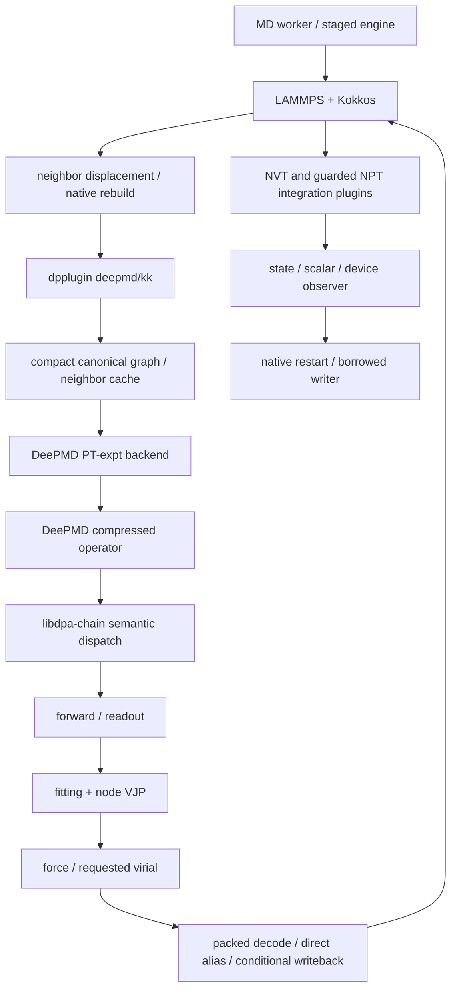

# DPA4C production architecture

The source entry is `production/dpa4c-runtime`. The active runtime audit, source
lock and validation identities determine the supported production composition.
Historical paths are recorded only in MIGRATION.md. No precompiled project
object or shared library is an input to this build.

`libdeepmd_op_pt.so` owns operator schemas, model cache priming and generic
fallbacks. `libdpa-chain.so` owns the production raw forward/force dispatch,
fitting dispatch, graph execution windows and packed-force integration.
The only production owners of `launch_raw_force_c8` and
`launch_raw_forward_c8` are in the chain entry. Internal implementations live
in separate semantic namespaces and call each other directly. The operator's
fallbacks have distinct names. `cmake/dpa-chain.exports` limits the chain's
public ELF boundary to the outer model dispatch and named integration helpers;
internal semantic implementations are private. Fitting and widening use explicit source
interfaces; no writable executable mapping or instruction trampoline exists.
Operator and chain use one canonical `Arguments` definition from
`include/dpa_chain/graph_compress_launch.h`. The build materializes this header
in the operator tree; pointer and flag layout no longer relies on a binary
layout placeholder.

The upstream DeePMD core, CUDA operators, dynamic CUDA adapter, C/C++ interfaces
and PT-expt backend are built from the same locked tree. The LAMMPS library
contains the selected neighbor, communication, device-temperature and timestep
overlays. The plugin build compiles every translation unit, including supporting
LAMMPS sources; it imports no historical object directory. Kokkos is linked once
inside LAMMPS. Integration plugins use its runtime rather than linking a second
static Kokkos instance.

The pair produces topology and coordinates on the Kokkos stream. A producer
event hands data to the PyTorch stream; a consumer event orders the return to
Kokkos. Execution windows wait on their actual producer, and force/virial
buffers stay device resident. Unsupported shapes, NULL maps, additional ranks,
nonidentity mappings or unsupported integration consumers use the preserved
generic paths. NPT full-centroid requests select all nine components; ordinary
global pressure requests use the verified six components. Output and restart
materialize packed force before read-only consumers.

The staged preload order is zerocopy restart, device restart, native state
plugin, device observer, chain, fitting launch adapter. LAMMPS auto-loads one
plugin directory containing pair, native state, NVT and NPT registrations.
Each integration style has one registration owner. The old priming hook is
part of operator source; the old combined forward/node library is absorbed by
the selected forward/readout/node implementations.

Public helper boundaries include `dpa_chain_set_need_virial_stream`,
`dpa_chain_requested_virial_device_pointer`, `dpa_chain_try_fitting_range`,
`dpa_chain_try_widen`, the `dpa_chain_small_nvt_*` consumers,
`dpa_direct_energy_force`, and `dpa_get_direct_neighbor_view`. LAMMPS plugin
entry points and the explicitly preserved output/restart interposition
methods are documented intentional ELF boundaries.
